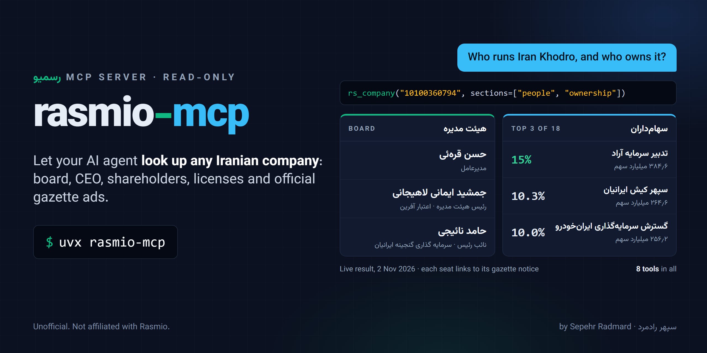

<!-- mcp-name: io.github.sepehr071/rasmio-mcp -->

<div align="center">



# rasmio-mcp: Rasmio (رسمیو) Iranian company registry MCP server for AI agents

**rasmio-mcp is an unofficial, read-only MCP server that gives AI agents Rasmio, the registry of Iranian companies.**<br>
Its 8 tools search companies with filters, open a company's registry profile (board, CEO, shareholders, licenses,<br>
capital history, official gazette ads), read gazette ads, show the companies a person manages, and look up products,<br>
trademarks, patents and industrial designs.<br>
No API key or Rasmio account is needed. It works in Claude, Cursor, Copilot and any other MCP client.

[](https://pypi.org/project/rasmio-mcp/)
[](https://pypi.org/project/rasmio-mcp/)
[](https://github.com/sepehr071/rasmio-mcp/actions/workflows/ci.yml)
[](https://github.com/sepehr071/rasmio-mcp/blob/main/LICENSE)

[For AI agents](#for-ai-agents) · [Quick start](#quick-start) · [Tools](#tools) · [Limits](#limits) · [فارسی](#فارسی)

</div>

---

## For AI agents

- **What:** unofficial MCP server for rasmio.com, a registry of Iranian companies built from the official gazette
  (روزنامه رسمی), the company registration office and other public sources.
- **Install:** `uvx rasmio-mcp` or `claude mcp add rasmio -- uvx rasmio-mcp`. Transport: stdio. Needs
  [uv](https://docs.astral.sh/uv/getting-started/installation/) (Python 3.10+).
- **Auth:** none. Optional `RASMIO_MCP_PROXY` (HTTP proxy URL, or a comma-separated list); system proxy settings are ignored.
- **Access:** read-only. It cannot log in, subscribe or edit anything.
- **Tools:** 8, all prefixed `rs_`. Typical sequences: `rs_search_companies` -> `rs_company` -> `rs_person` / `rs_ad`;
  `rs_search(kind="products")` -> `rs_product` -> `rs_search_companies(product_category=...)`.
- **Use when:** the user asks who runs or owns an Iranian company, its national id, registration number, capital,
  address, licenses or recent gazette notices; which companies a person is on the board of; who supplies a product;
  who owns a trademark.
- **Output:** compact JSON. Money is Rial. Dates are Persian (1404/06/26). Text is Persian as the site has it.

## Quick start

```bash
claude mcp add rasmio -- uvx rasmio-mcp
```

Other clients: run `uvx rasmio-mcp` as a stdio server.

## Tools

| Tool | What it returns |
|---|---|
| `rs_search_companies` | Companies by name or activity, filtered by province, city, status, legal form, size, capital, founding date, license, product category, brand/subsidiary/contract; sort by relevance, views, age or capital |
| `rs_company` | One company: founding date, status, legal form, registration number, economic code, national id, capital, activity, addresses, signature rule, board and CEO, other officers, auditors, shareholders and stock portfolio (listed companies), licenses, brands, patents and designs, capital changes, government contracts, Codal statements, 5 latest gazette ads |
| `rs_ad` | Full text of one official gazette ad |
| `rs_search` | People, products, brands, patents and industrial designs, or everything at once |
| `rs_person` | The companies a person manages, sits on the board of or audits, with dates and the gazette ad behind each role |
| `rs_product` | A product's specs (HS and ISIC codes, brand, maker, country), category and comparable suppliers |
| `rs_ip` | A trademark, patent or industrial design: numbers, date, owner, description |
| `rs_options` | Ids for the filters: legal forms, licenses, product categories, brand classes, provinces and cities |

## Limits

- Rasmio lets visitors without an account open only about **5 company profiles per IP address every 4 days**.
  `rs_company` says so plainly when the limit is reached; search and the other tools keep working.
- Sections Rasmio keeps for subscribers are not available: parent and subsidiary companies, the full ad archive
  (only the 5 latest ads are public), risk reports, the relationship graph.
- Privacy: people's national codes in gazette texts are shortened to their first 6 digits, as the site shows them.
  Person contact details are never returned.
- Not affiliated with Rasmio. Data is as public on rasmio.com; check official sources for legal decisions.

## فارسی

**rasmio-mcp** یک سرور MCP غیررسمی و فقط‌خواندنی برای سایت رسمیو است: جستجوی شرکت‌ها با فیلتر (استان، وضعیت، نوع
شرکت، سرمایه، تاریخ ثبت، مجوز)، پرونده‌ی شرکت (هیئت مدیره و مدیرعامل، سهام‌داران، مجوزها، تغییرات سرمایه، آخرین
آگهی‌های روزنامه رسمی)، متن کامل آگهی‌ها، سمت‌های هر شخص در شرکت‌ها، محصولات و برندها. بدون حساب کاربری کار می‌کند؛
رسمیو برای کاربر مهمان حدود ۵ پرونده‌ی شرکت در هر ۴ روز به ازای هر IP نشان می‌دهد.

## مجوز استفاده (License)

<a href="https://www.linkedin.com/in/sepehr-radmard"></a>

**استفادهٔ شخصی و غیرتجاری رایگان است.** استفاده در شرکت، محصول پولی یا پروژهٔ مشتری به مجوز تجاری نیاز دارد؛ از راه [لینکدین](https://www.linkedin.com/in/sepehr-radmard) یا [گیت&zwnj;هاب](https://github.com/sepehr071) با سپهر رادمرد تماس بگیرید. متن کامل: [PolyForm Noncommercial 1.0.0](https://github.com/sepehr071/rasmio-mcp/blob/main/LICENSE). نسخه&zwnj;های پیش از 0.2.1 با مجوز MIT منتشر شده&zwnj;اند و همان مجوز را دارند.

Free for personal and non-commercial use under the [PolyForm Noncommercial License 1.0.0](https://github.com/sepehr071/rasmio-mcp/blob/main/LICENSE). Using it in a company, a paid product or a client project needs a commercial license: contact Sepehr Radmard on [LinkedIn](https://www.linkedin.com/in/sepehr-radmard) or [GitHub](https://github.com/sepehr071). Versions before 0.2.1 were released under MIT and stay under it.

Made by Sepehr Radmard ([github.com/sepehr071](https://github.com/sepehr071) ·
[linkedin.com/in/sepehr-radmard](https://www.linkedin.com/in/sepehr-radmard)).
